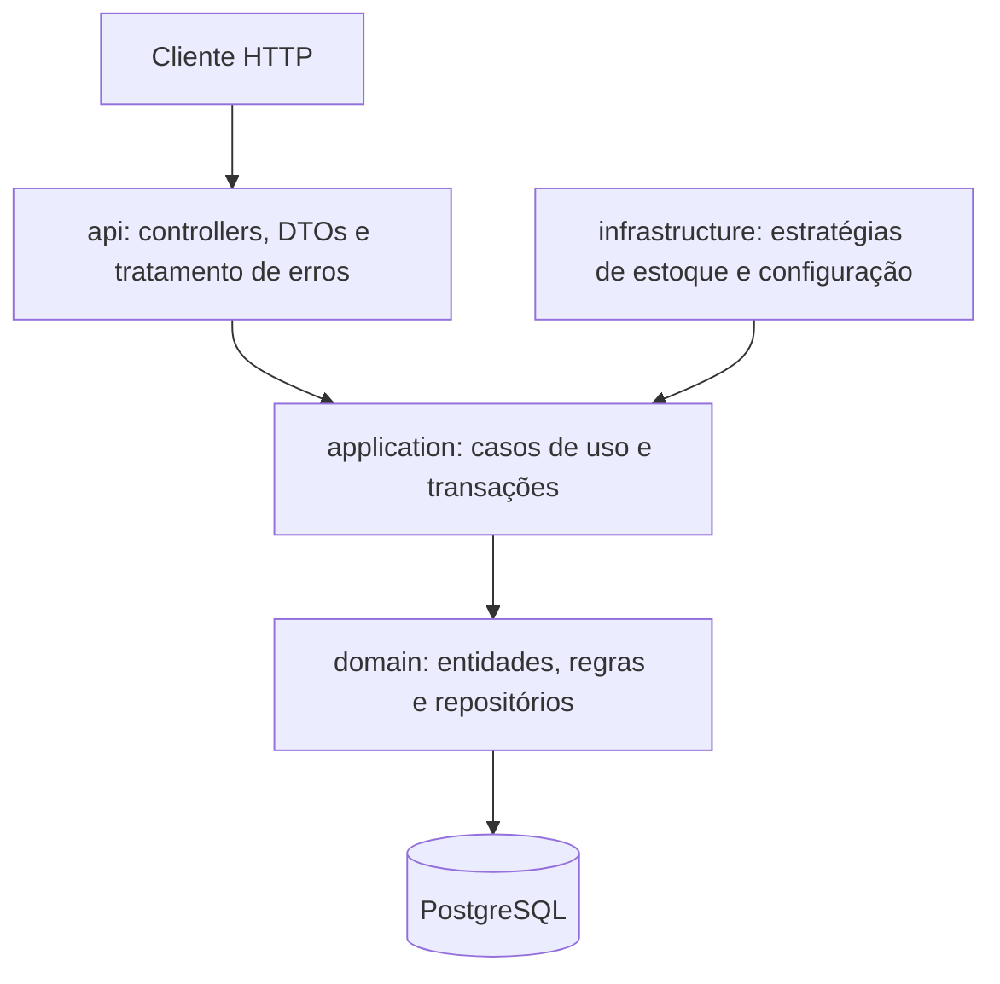
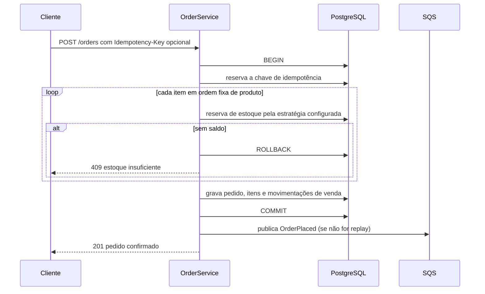
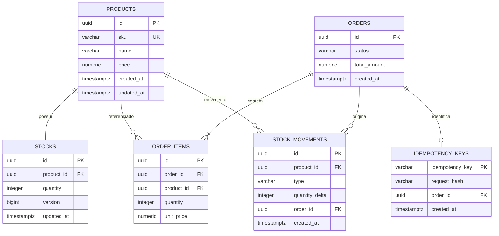

# Inventory Guard


Sistema de gestão de estoque que **não vende o que não tem**, mesmo sob concorrência.

## O problema

Existe um único iPhone em estoque. Duas pessoas tentam comprá-lo ao mesmo tempo. Se ambas leem "1 disponível" antes de qualquer baixa, o sistema vende duas unidades e só pode entregar uma. Não há erro de sintaxe nem exceção: o software simplesmente falha em silêncio.

Este projeto resolve esse problema e **prova a solução com testes automatizados** contra um PostgreSQL real.
## O que este projeto demonstra

- Baixa atômica de estoque no banco de dados
- Transação única entre baixa de estoque e registro do pedido, com rollback em caso de falha
- Comparação entre update condicional, lock otimista e lock pessimista
- Teste automatizado simulando compras simultâneas contra PostgreSQL real
- Idempotência na criação de pedidos
- Histórico imutável de movimentações de estoque
- **Sem deadlock:** itens processados em ordem fixa de produto
- **Ambiente reproduzível:** Docker Compose, Flyway, Testcontainers e CI no GitHub Actions
- **API documentada** com OpenAPI e Swagger UI

## Stack

- Java 21
- Spring Boot 4.0.9
- PostgreSQL 16
- Flyway
- Docker Compose
- GitHub Actions
- JUnit 5 e Testcontainers

## Execução rápida

Pré-requisito: Docker.

```bash
docker compose --profile app up --build
```

Depois de subir:

- Swagger UI: http://localhost:8080/swagger-ui/index.html
- Especificação OpenAPI: http://localhost:8080/v3/api-docs
- Health check: http://localhost:8080/actuator/health

### Desenvolvimento local

Pré-requisitos: JDK 21 e Docker.

```bash
docker compose up -d
./mvnw spring-boot:run
```

### Configuração

| Variável | Padrão | Descrição |
|---|---|---|
| `DB_URL` | `jdbc:postgresql://localhost:5432/inventory_guard` | URL do banco |
| `DB_USERNAME` | `inventory` | Usuário do banco |
| `DB_PASSWORD` | `inventory` | Senha do banco |
| `STOCK_STRATEGY` | `conditional-update` | `conditional-update`, `pessimistic-lock` ou `optimistic-lock` |
| `SERVER_PORT` | `8080` | Porta da aplicação |
| `AWS_SQS_ENDPOINT` | vazio | Endpoint SQS; vazio usa o endpoint padrão da AWS |
| `AWS_REGION` | `us-east-1` | Região AWS usada pelo SQS |
| `AWS_SQS_QUEUE_NAME` | `order-placed` | Nome da fila de eventos de pedido |
| `AWS_SQS_CONSUMER_ENABLED` | `false` | Ativa o consumidor SQS quando `true` |

## Controle de concorrência

A reserva de estoque usa uma de três estratégias, escolhida em `STOCK_STRATEGY`:

| Estratégia | Como funciona | Observações |
|---|---|---|
| `conditional-update` (padrão) | `UPDATE ... WHERE quantity >= :n`; o banco decide | Sem lock explícito, simples e rápido |
| `pessimistic-lock` | `SELECT ... FOR UPDATE` e depois decrementa | Concorrentes esperam na fila da linha |
| `optimistic-lock` | Coluna `version` e retentativa do pedido | Sob muita disputa, algumas tentativas se repetem |

Em todas, a baixa de estoque e o registro do pedido acontecem na mesma transação. Pedidos que citam os mesmos produtos em ordens opostas não geram deadlock, porque os itens são sempre processados em ordem fixa.

## Idempotência

`POST /api/v1/orders` aceita o header opcional `Idempotency-Key`.

| Situação | Resposta |
|---|---|
| Chave nova | `201` com o pedido criado |
| Mesma chave e mesmo conteúdo | `200` com o pedido original e `Idempotency-Replayed: true` |
| Mesma chave com conteúdo diferente | `422` |
| Chave mal formada | `400` |
| Pedido falhou (ex.: estoque insuficiente) | A chave não é consumida; um novo envio pode tentar de novo |

A chave é reservada com `INSERT ... ON CONFLICT DO NOTHING` antes de qualquer baixa de estoque, na mesma transação do pedido. Duas requisições simultâneas com a mesma chave não duplicam o pedido: a segunda espera a primeira terminar e recebe o resultado dela.

## Histórico de movimentações

Toda mudança de estoque gera uma linha imutável em `stock_movements` (estoque inicial, reposição ou venda). A soma das movimentações de um produto é sempre igual ao saldo atual. A imutabilidade tem duas barreiras: o repositório só expõe inserção e consulta, e um trigger no PostgreSQL rejeita `UPDATE` e `DELETE`.

## Evento OrderPlaced (SQS)

Após `OrderPlacer.place` retornar com sucesso e concluir sua transação, `OrderService` publica um evento `OrderPlaced` na fila configurada. O evento contém somente identificadores e dados dos itens, sem entidades JPA. Replays de uma `Idempotency-Key` não publicam novamente, e pedidos rejeitados não publicam evento.

O consumidor é opt-in: configure `AWS_SQS_CONSUMER_ENABLED=true` para ativar o long polling. Ele registra cada evento e o remove da fila somente após processá-lo.

**Limitações provisórias desta etapa (sem Transactional Outbox):**

- Se o pedido for confirmado no banco e o envio para SQS falhar, a aplicação registra o erro e ainda responde com o pedido confirmado. Se o cliente não receber essa resposta e repetir a requisição com a mesma `Idempotency-Key`, o sistema retorna o pedido original como replay e não tenta publicar o evento outra vez. Portanto, o evento pode se perder permanentemente; a Transactional Outbox é a solução planejada para fechar essa janela entre commit e publicação.
- A deduplicação do consumidor usa um conjunto em memória: reiniciar a aplicação apaga os IDs processados e instâncias diferentes não compartilham esse conjunto. É provisória e não oferece deduplicação durável ou distribuída.

### Testes de concorrência

Os mesmos cenários rodam contra as três estratégias, com PostgreSQL real:

- 20 compras simultâneas de um produto com 1 unidade: exatamente 1 sucesso
- 30 compras simultâneas de um produto com 5 unidades: exatamente 5 sucessos
- Pedidos com os mesmos produtos em ordens opostas: nenhum deadlock

```bash
./mvnw test -Dtest='*StockConcurrencyTest'
```

## Arquitetura

Arquitetura em camadas, com dependências apontando sempre para o domínio.



```
br.com.nevvesdev.inventory
├── api              controllers, DTOs, documentação OpenAPI e tratamento de erros
├── application      casos de uso, portas e orquestração transacional
├── domain           entidades, regras de negócio, exceções e repositórios
└── infrastructure   estratégias de reserva de estoque e configuração
```

## Fluxo de criação de pedido



## Modelo de dados



## API

A documentação interativa está no Swagger UI. Resumo:

| Método | Rota | Descrição |
|---|---|---|
| POST | `/api/v1/products` | Cria produto com estoque inicial |
| GET | `/api/v1/products` | Lista produtos com paginação |
| GET | `/api/v1/products/{id}` | Busca produto por id |
| GET | `/api/v1/products/{id}/stock` | Consulta o saldo de estoque |
| POST | `/api/v1/products/{id}/stock/replenishments` | Repõe estoque de forma atômica |
| GET | `/api/v1/products/{id}/stock/movements` | Histórico de movimentações |
| POST | `/api/v1/orders` | Cria pedido e baixa o estoque (aceita `Idempotency-Key`) |
| GET | `/api/v1/orders/{id}` | Busca pedido com seus itens |

Erros seguem o padrão Problem Details (RFC 9457).

## Testes

Os testes de integração usam Testcontainers: basta ter o Docker em execução.

```bash
./mvnw verify
```

| Camada | O que cobre |
|---|---|
| Unitários | Entidades, casos de uso e estratégias de reserva, com Mockito |
| API | Endpoints, validação e erros, com MockMvc e PostgreSQL real |
| Concorrência | Os cenários abaixo, rodando contra as três estratégias |
| Banco | Imutabilidade do histórico (trigger) e rollback transacional |
| Contrato | A especificação OpenAPI expõe todos os endpoints |

Cenários de concorrência (PostgreSQL real, mesmas verificações nas três estratégias):

- 20 compras simultâneas de um produto com 1 unidade: exatamente 1 sucesso
- 30 compras simultâneas de um produto com 5 unidades: exatamente 5 sucessos
- Pedidos com os mesmos produtos em ordens opostas: nenhum deadlock
- 15 requisições simultâneas com a mesma chave de idempotência: 1 pedido, 14 repetições
- O histórico de movimentações reconcilia com o saldo após a disputa

```bash
./mvnw test -Dtest='*StockConcurrencyTest'
```

## Decisões e trade-offs

- **Estoque separado do produto:** o registro mais disputado fica isolado, o que facilita aplicar lock e update condicional nele.
- **O banco é a última linha de defesa:** `CHECK (quantity >= 0)`, `UNIQUE (sku)` e chaves estrangeiras impedem estados inválidos mesmo se a aplicação errar.
- **Update condicional como padrão:** é a estratégia mais simples e não exige retentativa. As outras duas existem para comparar custos e comportamento.
- **Lock otimista exige retentativa fora da transação:** por isso a colocação do pedido é separada em `OrderPlacer` (transacional) e `OrderService` (repete em caso de conflito).
- **Chave de idempotência opcional:** preserva a compatibilidade da API. Torná-la obrigatória é uma mudança de uma linha.
- **Falha não consome a chave de idempotência:** como tudo acontece na mesma transação, o rollback do pedido desfaz a chave também.
- **Repositórios Spring Data na camada de domínio:** troca de pureza arquitetural por menos mapeamento e menos código. Se um dia for preciso, a separação é localizada.
- **Preço gravado no item do pedido:** mudanças futuras de preço não alteram pedidos antigos.

## Roadmap

- [x] Fase 0: scaffold, Docker Compose, Flyway e CI
- [x] Fase 1: modelo de domínio, migrations e endpoints básicos
- [x] Fase 2: baixa atômica e transação
- [x] Fase 3: testes de concorrência com Testcontainers
- [x] Fase 4: idempotência, ledger de movimentações e erros padronizados
- [x] Fase 5: OpenAPI e refinamento da documentação
- [ ] Opcional: reserva de estoque com expiração

## 👨‍💻 Desenvolvido por

João Victor · [GitHub](https://github.com/nevvesdev) · [LinkedIn](https://www.linkedin.com/in/nevvesdev/)

## Licença

Distribuído sob a licença MIT. Veja o arquivo [LICENSE](LICENSE).