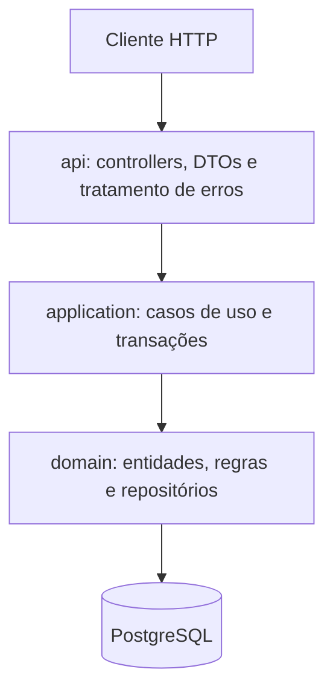
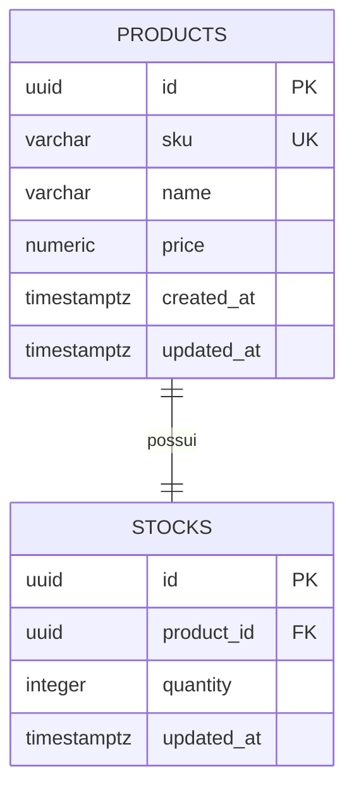

# Inventory Guard


Sistema de gestão de estoque que garante consistência sob concorrência.

## O problema

Existe um único iPhone em estoque. Duas pessoas tentam comprá-lo ao mesmo tempo. Se ambas leem "1 disponível" antes de qualquer baixa, o sistema vende duas unidades e entrega uma. Nenhum erro de sintaxe, nenhuma exceção: o software simplesmente falhou.

## O que este projeto demonstra

- Baixa atômica de estoque no banco de dados
- Transação única entre baixa de estoque e registro do pedido, com rollback em caso de falha
- Comparação entre update condicional, lock otimista e lock pessimista
- Teste automatizado simulando compras simultâneas contra PostgreSQL real
- Idempotência na criação de pedidos
- Histórico imutável de movimentações de estoque

## Stack

- Java 21
- Spring Boot 4.0.9
- PostgreSQL 16
- Flyway
- Docker Compose
- GitHub Actions
- JUnit 5 e Testcontainers

## Como executar

Pré-requisitos: JDK 21 e Docker.

```bash
docker compose up -d
./mvnw spring-boot:run
```

Health check: `http://localhost:8080/actuator/health`

## Testes

```bash
docker compose up -d
./mvnw verify
```

## Arquitetura

Arquitetura em camadas, com dependências apontando sempre para o domínio.



```
br.com.nevvesdev.inventory
├── api            controllers, DTOs e tratamento de erros
├── application    casos de uso e orquestração transacional
└── domain         entidades, regras de negócio e repositórios
```

### Decisões

- Estoque separado do produto: o registro mais disputado do sistema fica isolado.
- O banco é a última linha de defesa: `CHECK (quantity >= 0)`, `UNIQUE (sku)` e chaves estrangeiras.
- Nenhuma operação altera estoque com ler, somar e salvar. Toda mutação será atômica no banco (Fase 2).
- Erros padronizados com Problem Details (RFC 9457).

## Modelo de dados



## API

| Método | Rota | Descrição |
|---|---|---|
| POST | `/api/v1/products` | Cria produto com estoque inicial |
| GET | `/api/v1/products` | Lista produtos com paginação (`page`, `size`) |
| GET | `/api/v1/products/{id}` | Busca produto por id |
| GET | `/api/v1/products/{id}/stock` | Consulta o estoque do produto |

## Roadmap

- [x] Fase 0: scaffold, Docker Compose, Flyway e CI
- [x] Fase 1: modelo de domínio, migrations e endpoints básicos
- [ ] Fase 2: baixa atômica e transação
- [ ] Fase 3: testes de concorrência com Testcontainers
- [ ] Fase 4: idempotência, ledger de movimentações e erros padronizados
- [ ] Fase 5: OpenAPI e refinamento da documentação
- [ ] Opcional: reserva de estoque com expiração

## 👨‍💻 Desenvolvido por

João Victor · [GitHub](https://github.com/nevvesdev) · [LinkedIn](https://www.linkedin.com/in/nevvesdev/)

## Licença

Distribuído sob a licença MIT. Veja o arquivo [LICENSE](LICENSE).