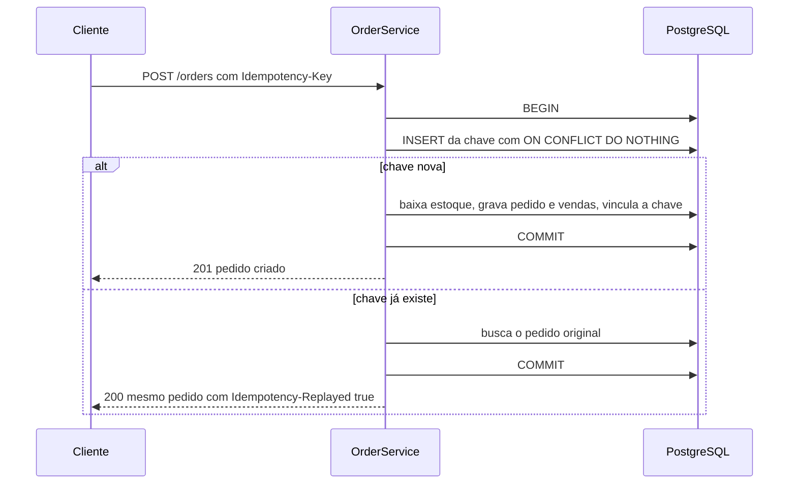
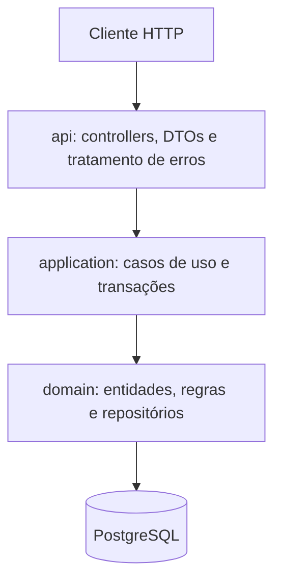
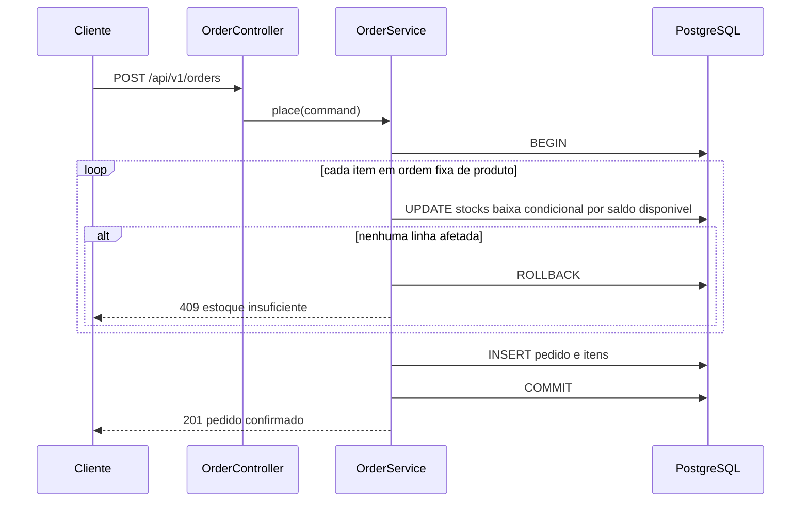
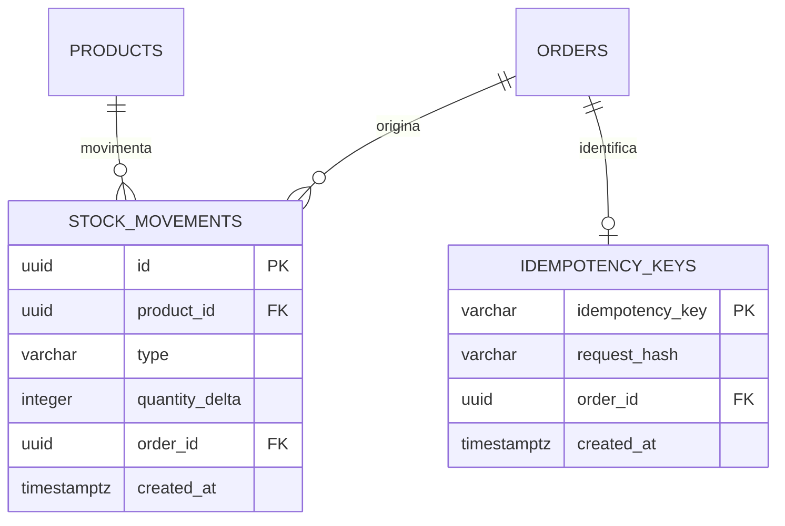

# Inventory Guard


Sistema de gestão de estoque que garante consistência sob concorrência.

## O problema

Existe um único iPhone em estoque. Duas pessoas tentam comprá-lo ao mesmo tempo. Se ambas leem "1 disponível" antes de qualquer baixa, o sistema vende duas unidades e entrega uma. Nenhum erro de sintaxe, nenhuma exceção: o software simplesmente falhou.

## O que este projeto demonstra

- Baixa atômica de estoque no banco de dados
- Transação única entre baixa de estoque e registro do pedido, com rollback em caso de falha
- Comparação entre update condicional, lock otimista e lock pessimista
- Teste automatizado simulando compras simultâneas contra PostgreSQL real
- Idempotência na criação de pedidos
- Histórico imutável de movimentações de estoque

## Stack

- Java 21
- Spring Boot 4.0.9
- PostgreSQL 16
- Flyway
- Docker Compose
- GitHub Actions
- JUnit 5 e Testcontainers

## Como executar

Pré-requisitos: JDK 21 e Docker.

```bash
docker compose up -d
./mvnw spring-boot:run
```

Health check: `http://localhost:8080/actuator/health`

## Testes

Os testes de integração usam Testcontainers: basta ter o Docker em execução, sem subir nada manualmente.

```bash
./mvnw verify
```

## Controle de concorrência

A reserva de estoque é feita por uma de três estratégias, escolhida pela propriedade `inventory.stock.strategy` (variável de ambiente `STOCK_STRATEGY`):

| Estratégia | Valor | Como funciona | Observações |
|---|---|---|---|
| Update condicional | `conditional-update` (padrão) | `UPDATE ... WHERE quantity >= :n`; o banco decide | Sem lock explícito, simples e rápido |
| Lock pessimista | `pessimistic-lock` | `SELECT ... FOR UPDATE` e depois decrementa | Concorrentes esperam na fila da linha |
| Lock otimista | `optimistic-lock` | Coluna `version` e retentativa do pedido | Sob muita disputa, algumas tentativas se repetem |

## Idempotência na criação de pedidos

`POST /api/v1/orders` aceita o header opcional `Idempotency-Key`. Um retry (por queda de rede, por exemplo) com a mesma chave não cria um segundo pedido nem baixa o estoque de novo.

| Situação | Resposta |
|---|---|
| Chave nova | `201` com o pedido criado |
| Mesma chave e mesmo conteúdo | `200` com o pedido original e o header `Idempotency-Replayed: true` |
| Mesma chave com conteúdo diferente | `422` |
| Chave mal formada | `400` |
| Pedido falhou (ex.: estoque insuficiente) | A chave não é consumida; um novo envio pode tentar de novo |



A reserva da chave acontece antes de qualquer baixa de estoque, dentro da mesma transação do pedido. Se duas requisições com a mesma chave chegam juntas, o PostgreSQL faz a segunda esperar a primeira terminar, e ela passa a receber o pedido original.

## Histórico de movimentações de estoque

Toda mudança de estoque gera uma linha imutável em `stock_movements`: estoque inicial, reposição ou venda (com o pedido de origem). A soma das movimentações de um produto é sempre igual ao saldo atual.

A imutabilidade tem duas barreiras: o repositório só expõe inserção e consulta, e um trigger no PostgreSQL rejeita `UPDATE` e `DELETE`.

Em todas, a baixa de estoque e o registro do pedido acontecem na mesma transação, e os itens são processados em ordem fixa de produto para evitar deadlock.

### Testes de concorrência

Os mesmos cenários rodam contra as três estratégias, com PostgreSQL real:

- 20 compras simultâneas de um produto com 1 unidade: exatamente 1 sucesso
- 30 compras simultâneas de um produto com 5 unidades: exatamente 5 sucessos
- Pedidos com os mesmos produtos em ordens opostas: nenhum deadlock

```bash
./mvnw test -Dtest='*StockConcurrencyTest'
```

## Arquitetura

Arquitetura em camadas, com dependências apontando sempre para o domínio.



```
br.com.nevvesdev.inventory
├── api            controllers, DTOs e tratamento de erros
├── application    casos de uso e orquestração transacional
└── domain         entidades, regras de negócio e repositórios
```

### Decisões

- Estoque separado do produto: o registro mais disputado do sistema fica isolado.
- O banco é a última linha de defesa: `CHECK (quantity >= 0)`, `UNIQUE (sku)` e chaves estrangeiras.
- A baixa de estoque é um `UPDATE` condicional atômico: o banco decide se há saldo, sem ler e decidir na aplicação.
- Pedido e baixa de estoque ocorrem na mesma transação: se qualquer item falha, nada é gravado.
- Itens do pedido são processados em ordem fixa de produto, o que evita deadlock entre pedidos concorrentes.
- Itens repetidos do mesmo produto são consolidados antes da baixa.
- O preço de cada item é gravado no pedido (snapshot), então mudanças futuras de preço não alteram pedidos antigos.
- Erros padronizados com Problem Details (RFC 9457).
- Chaves de idempotência são reservadas antes do trabalho, na mesma transação do pedido.
- O histórico de movimentações é append-only e imutável também no banco, por trigger.

## Fluxo de criação de pedido



## Modelo de dados



## API

| Método | Rota | Descrição |
|---|---|---|
| POST | `/api/v1/products` | Cria produto com estoque inicial |
| GET | `/api/v1/products` | Lista produtos com paginação (`page`, `size`) |
| GET | `/api/v1/products/{id}` | Busca produto por id |
| GET | `/api/v1/products/{id}/stock` | Consulta o estoque do produto |
| POST | `/api/v1/products/{id}/stock/replenishments` | Repõe estoque de forma atômica |
| POST | `/api/v1/orders` | Cria pedido e baixa o estoque na mesma transação |
| GET | `/api/v1/orders/{id}` | Busca pedido com seus itens |
| POST | `/api/v1/orders` | Cria pedido e baixa o estoque na mesma transação (aceita `Idempotency-Key`) |
| GET | `/api/v1/products/{id}/stock/movements` | Lista o histórico de movimentações do estoque, da mais recente para a mais antiga |

## Roadmap

- [x] Fase 0: scaffold, Docker Compose, Flyway e CI
- [x] Fase 1: modelo de domínio, migrations e endpoints básicos
- [x] Fase 2: baixa atômica e transação
- [x] Fase 3: testes de concorrência com Testcontainers
- [x] Fase 4: idempotência, ledger de movimentações e erros padronizados
- [ ] Fase 5: OpenAPI e refinamento da documentação
- [ ] Opcional: reserva de estoque com expiração

## 👨‍💻 Desenvolvido por

João Victor · [GitHub](https://github.com/nevvesdev) · [LinkedIn](https://www.linkedin.com/in/nevvesdev/)

## Licença

Distribuído sob a licença MIT. Veja o arquivo [LICENSE](LICENSE).